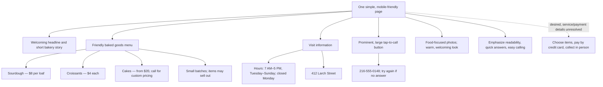

# Maria's Bakery website requirements

## What Maria wants

Maria wants one simple, welcoming page that helps people quickly decide what to try, when to visit, and how to reach the bakery. Most visitors will use phones. Keep text easy to read, make the phone action prominent and tap-to-call, and make the food the visual focus. She wants a warm neighborhood-bakery feeling, a short story, and no pink. *(Evidence: `inputs/client_transcript.md`.)*

### Content and evidence

- **Welcome/about:** A welcoming headline and a brief account of the bakery; keep the story short. Maria values a place where customers can stop in and chat. *(Transcript.)*
- **Menu:** Sourdough loaf $8, croissant $4 each, cakes from $35. Explain that cake price depends on size and customer preferences, so customers should call. Keep the menu short and friendly. *(Transcript.)*
- **Availability:** Say baked goods are made in small batches and may sell out; do not imply every item is available all day. *(Transcript.)*
- **Visit:** 412 Larch Street; open 7:00 AM–5:00 PM Tuesday through Sunday; closed Monday. Maria says a clear address is enough and does not need a fancy map. *(Transcript.)*
- **Call:** 216-555-0148 as a large, easy-to-find call button. If Maria cannot answer because she is baking, ask visitors to try again. *(Transcript.)*
- **Visual style:** Warm, welcoming, food first. Use suitable bakery and food imagery. The supplied `inputs/photos/01_sourdough.png`, `02_croissants.png`, `03_cake.png`, `04_counter.png`, and `05_storefront.png` are explicitly labeled “Placeholder image”; confirm whether they are placeholders before treating them as final photography. *(Photo files.)*
- **Logo:** `inputs/logo.png` is a pink circle with the bakery name. Maria says she hates pink, while also saying she sent the logo she uses. Ask whether to retain the logo unchanged, recolor it, or omit it. *(Transcript and logo.)*
- **Online ordering:** Maria wants customers to choose bread or cake, pay by credit card, and collect their order. She has not selected an ordering or payment service and asks to see a simple proposal before anything complicated. This needs discovery and feasibility review before promising it as a working feature. *(Transcript.)*

## Contradictions to resolve

The transcript is the clearest source of Maria's current wishes, but the flyer differs on three important customer-facing facts. Confirm these with Maria before publishing:

| Detail | Transcript | `inputs/flyer.png` | Temporary assumption |
|---|---|---|---|
| Hours | 7 AM–5 PM; closed Mondays | 7 AM–6 PM, open 7 days | Use transcript hours for planning; confirm current hours. |
| Sourdough | $8 per loaf | $9 | Use transcript price for planning; confirm current price. |
| Phone | 216-555-0148 | 216-555-0184 | Use transcript number for planning; confirm the correct number. |

## Questions for Maria

1. Which hours, sourdough price, and phone number are current: the transcript or the flyer?
2. Should the pink logo be kept, recolored, or left out?
3. Are the five bakery pictures placeholders or approved images for the site?
4. For online ordering, which items should be orderable, how far ahead should customers order, and what pickup details should be shown? Is a simple order-request form acceptable while payment-service choices are explored?
5. What ordering/payment service, if any, does Maria want the team to consider? No provider is specified in the inputs.

## Handoff to the team

- **Agreed direction from the transcript:** one readable, phone-first page; short welcoming copy; concise menu and clear prices; accurate hours, address, and tap-to-call contact; food-led, warm presentation; no pink as a general visual preference; clear small-batch availability note.
- **Emphasize:** legibility, at-a-glance hours and location, a conspicuous call action, food photos, and friendly neighborhood character.
- **Temporary assumptions:** transcript facts are used for initial planning where the flyer conflicts; online ordering is a desired but not yet specified/validated feature.
- **Open decisions:** conflicting flyer facts, pink logo treatment, image readiness, and online-ordering/payment workflow.

## Assignments for the rest of the team

Each person should first read their own role `AGENTS.md`, use only `inputs/` for factual claims, and edit only the file named in that role's instructions. Keep the assumptions and open decisions above visible in the handoff; do not silently choose between conflicting flyer and transcript details.

### Copywriter — `roles/02_copywriter/copy.md`

- Write a concise welcome headline and a short bakery introduction that conveys the friendly neighborhood feel.
- Draft the short menu with sourdough, croissant, and cake prices, including a note that cake pricing depends on the request and that items can sell out because baking is done in small batches.
- Provide clear visit details and friendly call-to-action text, including an instruction to try calling again if there is no answer.
- Check every factual claim against `inputs/`; flag the hours, sourdough price, phone number, logo, and online-ordering decisions as unresolved until confirmed. Do not invent product availability or order/payment details.
- Review the copy and hand it to the leader.

### UI/UX Designer — `roles/03_ui_ux_designer/styles.css`

- Read `shared/page_structure.md` and style its exact section IDs and classes.
- Make the layout phone-first and easy to scan, with strong prominence for the call action, hours, address, and food menu; keep the story secondary and short.
- Use a warm, welcoming direction that avoids pink as the general palette; keep the food imagery visually prominent. Treat the pink logo and placeholder photos as unresolved choices, not as approved assets.
- Check text size of at least 16px, buttons of at least 44px, contrast, keyboard focus, and narrow-screen behavior; review the CSS and hand it to the developer.

### Web Developer — `roles/04_web_developer/index.html`

- Read `shared/page_structure.md` and build the page using its exact IDs and classes, with the planned welcome, menu, hours, about, contact, and footer areas.
- Link the stylesheet and place suitable supplied image assets where useful, while recognizing that the bakery photos are labeled placeholders.
- Make the phone action a `tel:` link. Use the transcript number only as a temporary assumption until the flyer conflict is resolved.
- Check the stylesheet link, images, section links, and phone layout; review the HTML and hand it to the leader. Do not implement a live credit-card checkout or claim online ordering works before Maria chooses a service and the team agrees on the workflow.

## Team workflow and completion steps

1. **Resolve client-facing facts:** Ask Maria to confirm the hours, sourdough price, and phone number; ask about the pink logo and whether the photo assets are placeholders. Record answers in the appropriate role deliverable. Keep temporary assumptions labeled until then.
2. **Complete role work independently:** Copywriter fills `copy.md`; UI/UX Designer fills `styles.css`; Web Developer fills `index.html`. Each follows their own `AGENTS.md`, checks their work, and hands off to the next teammate as stated there. Do not edit another role's files, `inputs/`, `shared/`, or any `AGENTS.md`.
3. **Submit and merge role work:** When a student says they are done, ask whether they are ready to submit, then collect which input they checked against. Commit and push their role file and review note, then merge that role branch into `main` per the root session guide. Stop and tell the leader if a merge conflict appears.
4. **Verify team completion:** A role is done only when its role file differs from its starting template and its `.review/<role>_<firstname>.md` exists on `origin/main`. A pushed but empty branch is not done. Report the number complete and who is waiting; start the final build only once all four roles are done and merged.
5. **Leader's final build:** After all four roles merge, create/resume the leader's `final/<firstname>` branch from updated `main`. Work only in `final/`. The team deliverables for this phase are:
   - A mobile-friendly Maria's Bakery website assembled from the approved copy, styles, and page structure. Keep the phone action and practical visit details easy to find; do not claim online payment/order capability until a service and process are agreed.
   - `questions_for_maria.md`, consolidating the unresolved hours, sourdough price, phone number, logo/photo approval, and online-order/pickup decisions into concise questions for Maria.
   - A five-minute presentation that explains Maria's goals, the site structure and key emphasis, the choices reflected in the build, and the questions or next steps still needing her input. Keep facts grounded in `inputs/` and identify open decisions instead of presenting assumptions as confirmed.
   When the team agrees, commit and push the final work, then merge it into `main` using the root session guide.

## Business analyst completion check

- [x] Read `inputs/client_transcript.md`, `inputs/flyer.png`, `inputs/logo.png`, and all five files in `inputs/photos/`.
- [x] Listed Maria's needs with input evidence and preserved the requested diagram above.
- [x] Compared transcript and flyer; documented all three conflicts.
- [x] Listed the questions and temporary assumptions.
- [x] Added role-scoped assignments and the team completion sequence; reviewed this handoff against the business analyst checklist.
- [ ] Confirm open decisions with Maria when possible; leave them flagged if answers are not available before handoff.
